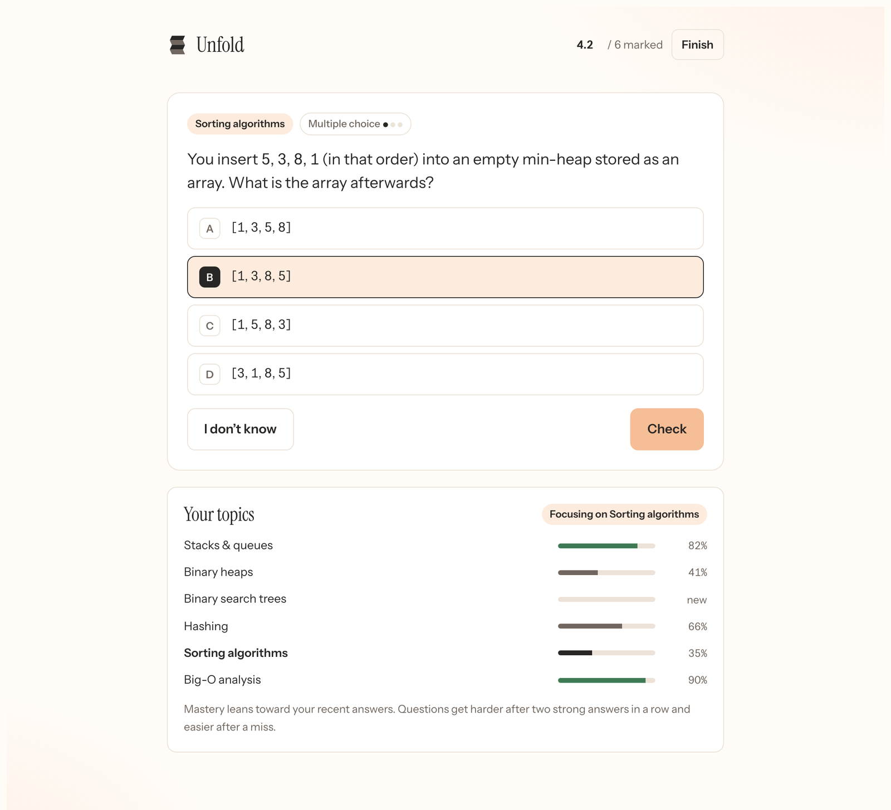
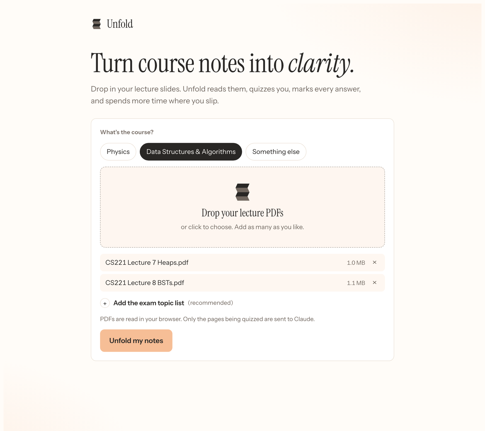
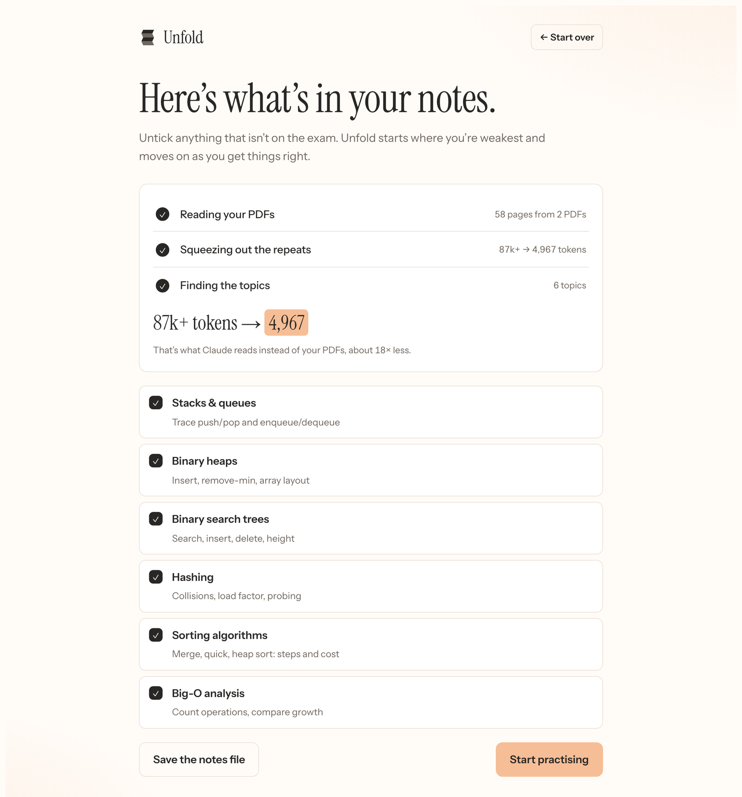
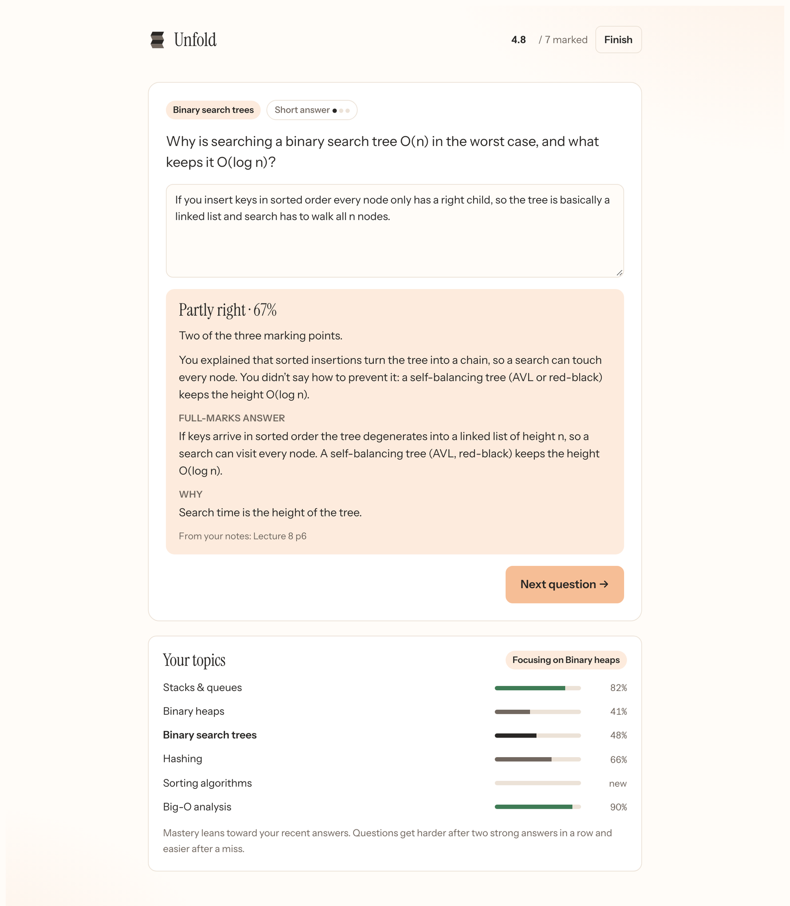

<p align="center"></p>

<p align="center"><b>Turn course notes into clarity.</b><br>Drop in your lecture PDFs. Unfold finds the exam topics, quizzes you, marks every answer with partial credit, and spends more time where you slip.</p>

<p align="center"><a href="https://claude.ai/artifact/V6E7BXJvt7WjDbUuwAQxpN"><b>▶ Open Unfold</b></a> · <a href="https://shayjah.github.io/Unfold/">Product site</a></p>



## How it works

| 1. Drop in your slides | 2. Unfold finds the topics | 3. Practise where you slip |
|---|---|---|
|  |  |  |
| Pick the course (physics, DSA or other), drop in your PDFs, paste the exam topic list. | It strips repeated slide build-ups, headers and page numbers, then groups the slides into exam topics. | Every question comes from your notes and names its slide. Your weakest topic comes up most. |

- **Much less to read.** 58 lecture slides came out as 4,967 tokens of notes, against 87k+ tokens as PDFs (about 18× less).
- **Partial credit.** Short answers are marked by Claude against a rubric; select-all, ordering and calculations get credit for the parts you got.
- **Adaptive.** Mastery per topic follows your recent answers. Questions go up a level after two strong answers in a row and down after a miss.
- **Built for physics and DSA.** Calculations with units and tolerance (`3x10^8` works), sign and power-of-ten hints; traces, Big-O and algorithm-step questions.
- **Private by default.** PDFs are read in the browser. Only the text of the slides being quizzed goes to Claude.

## Using it

**[Open Unfold](https://claude.ai/artifact/V6E7BXJvt7WjDbUuwAQxpN)** in claude.ai. The first time, claude.ai asks whether Unfold may use Claude: choose Allow. Questions and marking use a little of your own Claude usage.

The copy at [`app/`](app/) (also on the [product site](https://shayjah.github.io/Unfold/app/)) runs anywhere, but outside claude.ai it can only compress PDFs into a notes file. The questions need Claude.

## What's in this repo

| Path | What it is |
|---|---|
| `index.html` | The product site (GitHub Pages) |
| `app/index.html` | The Unfold app: upload → parse → adaptive quiz, one self-contained file |
| `assets/` | Screenshots and favicon for the site |
| `brand/` | Brand kit: logo files, colour and type tokens, guidelines PDF |
| `SKILL.md`, `templates/`, `course-pack/`, `scripts/` | The study kit Unfold grew out of (below) |

### Brand
Pleat: four folded panels in ink and muted. Instrument Serif for headings, Instrument Sans for text. Paper `#FFFCF8`, White `#FFFFFF`, Apricot `#F6BE96` (primary actions, always with ink text), Apricot tint `#FDEBDD`, Ink `#292725`, Muted `#71675F`. Full rules in [`brand/unfold-guidelines.pdf`](brand/unfold-guidelines.pdf).

### Publishing the site
Settings → Pages → Deploy from a branch → `main`, folder `/ (root)`. The site goes live at `https://shayjah.github.io/Unfold/`.

## Study kit (Claude skill)

Build a fixed practice quiz and a one-page cheat sheet for a specific exam with Claude Code.

| Path | What it is |
|---|---|
| `SKILL.md` | Instructions Claude follows (works as a Claude skill) |
| `templates/quiz-template.html` | Quiz with mock exam, topic drills and generated questions. Only the `COURSE` block changes per course |
| `templates/cheatsheet-template.html` | 1-page, 3-column printable layout |
| `course-pack/COURSE.md` | Fill in per exam; give it to Claude instead of the PDFs |
| `course-pack/notebooklm-prompt.md` | Prompt to condense slides with NotebookLM or Gemini |
| `scripts/extract_notes.py` | PDFs → compact Markdown from the terminal |
| `scripts/check_quiz.js` | Checks every question grades correctly before you use it |

Install as a skill:
```bash
git clone https://github.com/ShayJah/Unfold ~/.claude/skills/study-drill
```
Then ask Claude: "Use the study-drill skill with this COURSE.md for my physics midterm."
